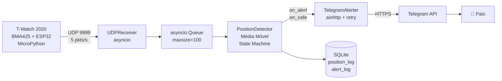

# BabyGuard

**Sistema de monitoramento de posição do bebê com alertas em tempo real via Telegram**


---

## O Problema

A Síndrome da Morte Súbita do Lactente (SMSL/SIDS) é a principal causa de morte em bebês entre 1 e 12 meses em países desenvolvidos, com cerca de **3.500 mortes anuais nos EUA** segundo o CDC. Um dos fatores de risco mais associados é o bebê dormir de bruços — médicos recomendam universalmente a posição de costas.

O problema: bebês se movem durante o sono, e os pais não podem vigiar 24h.

## A Solução

O BabyGuard monitora a posição do bebê em tempo real e envia alertas urgentes no Telegram dos pais se o bebê permanecer de bruços por mais de 5 segundos.

```
Pais dormem tranquilos — o BabyGuard vigia.
```

### Como funciona

1. Um **T-Watch 2020** (smartwatch com ESP32) é fixado na roupa do bebê
2. O acelerômetro BMA425 lê a orientação 5x por segundo
3. Os dados são enviados via **UDP** para um servidor local
4. Um servidor Python com **asyncio** detecta posições de risco
5. Se face down por >5 segundos: **10 alertas consecutivos** no Telegram

---

## Demo

### Demo Notificação tela apagada


### Demo Notificação chat telegram


---

## Features

- **Detecção robusta**: média móvel suaviza ruído do acelerômetro — sem falsos alarmes por batidas
- **Alertas repetidos**: ciclos de 10 mensagens se repetem a cada 30s até o bebê ser virado
- **Watchdog no firmware**: se o ESP32 travar, reseta automaticamente em 8 segundos
- **Reconexão WiFi**: backoff exponencial garante que o relógio sempre volta à rede
- **Heartbeat monitor**: servidor alerta no Telegram se o relógio parar de enviar dados
- **Validação de pacotes**: servidor rejeita pacotes malformados antes de processar
- **Retry com backoff**: falhas da API Telegram são retentadas automaticamente
- **Histórico SQLite**: todos os eventos persistidos para análise posterior
- **Dashboard opcional**: visualização em Streamlit (não recomendado em Raspberry Pi Zero)
- **Graceful shutdown**: desligamento limpo com confirmação no Telegram

---

## Arquitetura



### Componentes

| Componente | Responsabilidade |
|------------|-----------------|
| `firmware/main.py` | Loop principal do ESP32: lê sensor, envia UDP, gerencia WiFi e watchdog |
| `firmware/bma423.py` | Driver I2C para o acelerômetro BMA425 |
| `server/udp_receiver.py` | Recebe e valida pacotes UDP, alimenta a fila |
| `server/position_detector.py` | Média móvel + máquina de estados SAFE/COUNTING/ALERT |
| `server/telegram_alerter.py` | Envia alertas com retry, rate limiting e ciclos repetidos |
| `server/database.py` | Persistência SQLite de posições e alertas |
| `server/babyguard_server.py` | Orquestrador: inicia tudo e gerencia heartbeat |

---

## Stack Tecnológica

| Tecnologia | Motivo da escolha |
|------------|-------------------|
| **MicroPython** | API de sockets/JSON nativa, iteração rápida sem compilação |
| **UDP** | Fire-and-forget ideal para telemetria; dados obsoletos são descartados |
| **asyncio** | I/O-bound dominante; zero overhead de threads no Raspberry Pi Zero W2 |
| **aiohttp** | Único cliente HTTP async maduro para Python |
| **SQLite** | Sem servidor, zero RAM em idle, backup trivial |
| **Telegram Bot API** | Notificações push gratuitas, sem app dedicado |
| **python-dotenv** | Segredos fora do código, sem dependências extras |

---

## Quick Start

### Pré-requisitos

- Python 3.11+
- T-Watch 2020 (LilyGo) com MicroPython instalado
- Bot do Telegram criado via [@BotFather](https://t.me/botfather)
- Ambos (relógio e servidor) na mesma rede WiFi

### 1. Configurar o servidor

```bash
git clone https://github.com/gleissonbispo/babyguard.git
cd babyguard

python -m venv .venv
.venv/Scripts/activate          # Windows
# source .venv/bin/activate     # Linux/Mac

pip install -r server/requirements.txt
```

Copie e preencha o `.env`:
```bash
cp .env.example .env
# Edite .env com seu token do Telegram e chat_id
```

### 2. Configurar o firmware

Edite `firmware/config.py` com sua rede e IP do servidor:
```python
WIFI_SSID = "NomeDaRede"
WIFI_PASSWORD = "senha"
SERVER_IP = "192.168.1.XXX"  # IP do PC/Raspberry Pi
```

Faça upload de todos os arquivos `firmware/` para o T-Watch via Thonny ou mpremote.

### 3. Executar

```bash
# No PC/Raspberry Pi:
cd babyguard
python server/babyguard_server.py

# O relógio inicia automaticamente quando ligado
```

Você receberá uma mensagem no Telegram confirmando que o sistema está ativo.

---

## Testes

```bash
# Instalar dependências de teste
pip install pytest pytest-asyncio

# Rodar todos os testes
pytest

# Com cobertura detalhada
pytest -v --tb=short

# Apenas testes de integração
pytest tests/test_integration.py -v
```

Os testes não precisam de hardware, Telegram ou internet — todos os componentes externos são mockados.

---

## Deploy em Produção (Raspberry Pi Zero W2)

Veja o guia completo em [`docs/DEPLOY_RASPBERRY.md`](docs/DEPLOY_RASPBERRY.md).

Resumo:
1. Flash Raspberry Pi OS Lite (64-bit)
2. Instalar Python 3.11+ e criar venv
3. Configurar `.env` no Pi
4. Criar serviço systemd para auto-start no boot

```bash
# Verificar se está rodando
systemctl status babyguard

# Ver logs em tempo real
journalctl -u babyguard -f
```


---

## Disclaimer

> **Este sistema é um auxiliar, NÃO um substituto à supervisão parental.**
> 
> O BabyGuard pode apresentar falsos negativos (não detectar uma situação de risco) por falhas de hardware, WiFi, bateria, ou posicionamento incorreto do dispositivo. **Sempre siga as orientações médicas sobre segurança do sono infantil** e mantenha supervisão adequada independentemente deste sistema.


---

## Autor

**Gleisson Bispo** 

---

*"Prefira falsos positivos a falsos negativos: é melhor acordar os pais sem necessidade do que não acordar quando precisa."*
